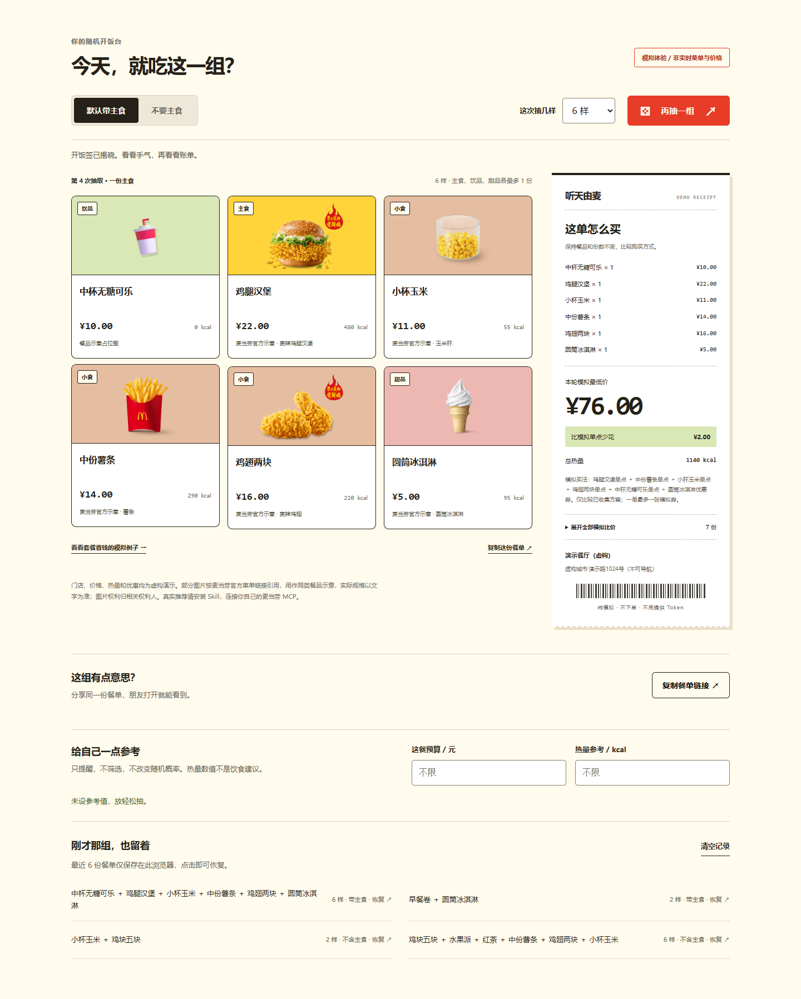
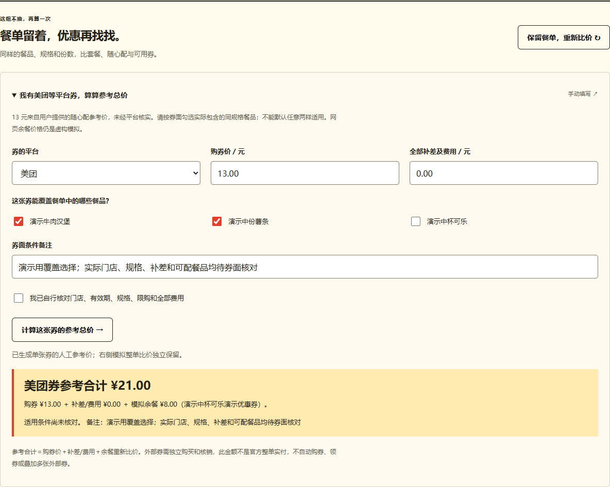
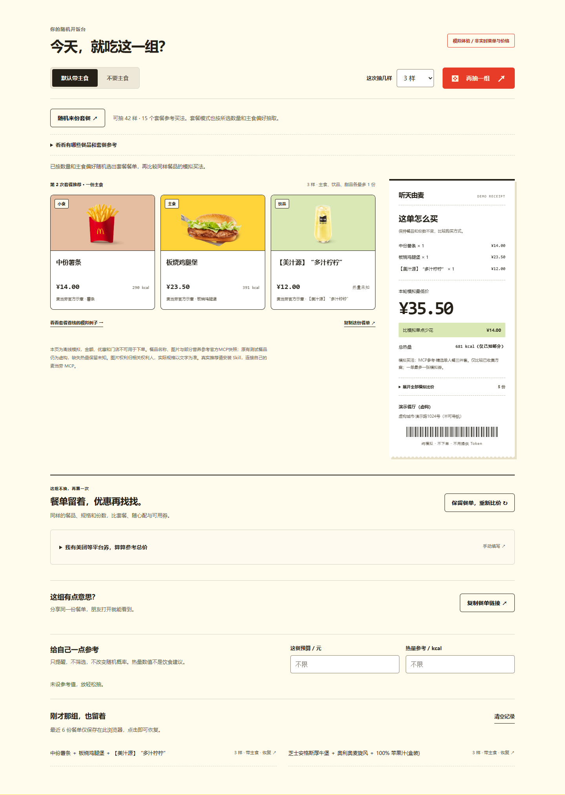

# 听天由麦 · mcd-random-meal

不知道吃什么？从当前门店随机抽1–6样不同餐品（默认3样），展示门店地址、价格和热量，再为同一份餐单比较优惠买法。默认恰好一份主食；说“不要主食”就排除汉堡、卷、饭、面、粥、三明治等。薯条按小食处理。按单人餐规则，主食、饮品、甜品各最多1份；不要主食时为0份，剩余数量随机选小食。饮品和甜品可以都不选。

**[在线试玩 →](https://ting-tian-you-mai-demo.silkypony128.chatgpt.site)** · [38 秒交互录屏](assets/demo.mp4) · [安装 Skill](#安装-skill)


## 先玩一把

无需登录、无需 Token，打开网页即可选择1–6样、切换“不要主食”、查看每份热量并比较同一餐单的购买方式。网页小票使用**离线模拟金额、门店和优惠**；新增餐品的名称、图片与已知营养参考官方MCP快照，原13样构造数据保留，缺图时显示占位。真实门店查询和官方核价由本机 Skill 完成。网页另展示真实联调历史记录。

抽签时有短促骰子动效与揭晓反馈，连续点击不会重复抽取。最近6份餐单和当前餐单可在此浏览器恢复，也可复制链接让朋友打开同一份模拟餐单。可选填预算与热量参考值：只提示差额，不筛选餐品、不改变随机概率。浏览器禁止存储或复制时会提示替代方式；系统开启“减少动态效果”后会关闭非必要动效。

餐品池现为42样，新增29样取自官方MCP常见餐品参考，包括板烧鸡腿堡、麦香鸡、双层吉士汉堡、安格斯厚牛堡、脆薯饼、脆汁鸡、奥利奥麦旋风及多种饮品。价格和优惠继续为离线模拟；原13样测试数据保留，新增已知营养来自快照，缺失显示未知。不是实时门店供应。

套餐入口会显示当前可抽的样数，按数量和主食偏好选套餐，再比较同样餐品怎么买。选择1样或4–6样时，点击会在按钮旁展开“抽2样套餐／抽3样套餐”，明确选择后才更改数量；生成过程和结果都有就近反馈。也可以展开查看餐品库与12组官方套餐历史核价。当前模板为2–3样，6样请求不会自动变成双人餐或多汉堡。普通随机不因优惠而改变概率。


<details>
<summary>查看桌面与手机效果图</summary>

桌面截图展示固定模拟案例（不是一次随机结果）：相同三样餐品模拟单点48元，组合为模拟套餐29元。


6样单人餐随机演示，主食恰好1份，饮品和甜品各最多1份，其余为小食；金额和热量均为模拟值：




</details>

录屏约38秒，为此前13样演示池版本的实际操作，展示1–6样单人餐、官方示意图、骰子抽签、不要主食、历史恢复、预算/热量提醒，以及复制并打开分享链接；42样餐品与新套餐入口以当前网页和截图为准。分享链接已用全新浏览器会话验证能恢复同一份餐单。带中文字幕，无旁白；H.264 MP4约4MB，适合随群消息发送。[下载 MP4](assets/demo.mp4) · [群分享文案](assets/group-post.txt)。原创插画由内置 image_gen 生成，[完整提示词与素材说明](assets/image-prompt.md)随项目保留。

本项目为麦当劳程序员创意开发大赛参赛作品，由参赛者独立开发，非麦当劳官方产品。

项目仓库：https://github.com/dayebishouji/mcd-random-meal

参赛报名：[官方报名 Issue #1196](https://github.com/M-China/mcd-developer-innovation-challenge/issues/1196)，报名状态以该 Issue 下的官方回执为准。

## 使用示例

- “深圳福田，随机推荐麦当劳，给我地址、价格和热量。”
- “不要主食，重新随机三样，再帮我算优惠。”
- “只来1样，要主食。”
- “深圳福田，不要主食，随机推荐6样。”
- “这一组挺好，保持餐品不变，看看套餐买会不会更便宜。”
- “深圳福田，随机推荐一份3样的单人套餐。”
- “不要主食，推荐2样的随心配。”

目标用户：不想反复翻菜单、希望看到真实价格与热量的普通用户。随机规则不按热量、价格、热门程度或优惠加权。默认规格参与抽取，默认恰好1份主食，其余随机选小食，饮品和甜品各最多1份；不支持用“随机”掩饰人工挑选。

## 保留餐单，优惠再算一次

新增“保留餐单，重新比价”按钮。餐品不变，按当前模拟优惠重算；真实 Skill 使用下列命令刷新原门店套餐、随心配和已有券，然后官方整单核价：

```text
python scripts/main.py reprice --input local/live.json --output local/repriced.json --html local/repriced.html
```

原餐单及份数不变，不新抽取。套餐按实际子项编码、份数、规格与特调核对，不能靠名称相似换大杯或加餐。保留单点对照，套餐较多时优先比较能覆盖多样餐品的入口，达到上限会标记截断。

网页另有美团等平台券的手动参考区：按券面勾选覆盖餐品，填购券价、补差及费用，再为余餐重新比价。**13元只是用户提供、未经平台核实的随心配参考价，不表示任意两样适用。** 外部券合计与官方核价独立展示，不自动查询美团、购券或下单。真实券输入格式见 [重新核价说明](references/repricing.md)。



## 常见餐品与套餐参考库

通过官方MCP查询深圳福田3家门店，整理了[46种独立单品](references/menu-catalog.json)，其中39种为常见参考候选；另外保存[32个套餐/随心配等入口与12组历史官方整单核价](references/bundle-catalog.json)。接口没有永久/常驻标记，不能承诺全年或全国供应。来源、门店、规格、补差与边界见[餐品与套餐库说明](references/catalog.md)。

真实套餐模式会重新核验当前门店及规格，再进行官方整单核价：

```text
python scripts/main.py live --city 深圳市 --keyword 福田 --bundle --count 3
python scripts/main.py live --city 深圳市 --keyword 福田 --bundle --no-main --count 2
```

仅在用户明确要套餐时使用此模式。主食、饮品、甜品各最多1份，套餐内食品分别计数；当前模板不匹配时明确报出，不自动改餐。缓存价格不作为当前实付。



## 安装 Skill

需要 Python 3.10 或更新版本，无第三方依赖。将整个 `mcd-random-meal` 文件夹复制到所用 Agent 的技能目录，例如 Codex 的用户技能目录或 WorkBuddy 的用户技能目录；保持 `SKILL.md`、`scripts/`、`references/` 同级。由 Agent 加载 `SKILL.md` 并使用已连接的麦当劳 MCP。

```text
git clone https://github.com/dayebishouji/mcd-random-meal.git
cd mcd-random-meal
```

本机命令模式需要自行在私有环境中设置 `MCD_MCP_TOKEN`。不要把真实 Token 放进源码、公开配置、截图或命令行参数。配置模板只含环境变量占位符，不保证所有客户端都会自动展开，需按客户端实际配置方式处理。

首次使用先执行 `python scripts/main.py doctor --offline` 检查安装；配置凭据后运行 `python scripts/main.py doctor` 检查真实连接和所需只读工具。该检查不打印凭据值。具体恢复步骤见 [连接检查与故障恢复](references/troubleshooting.md)。

## 先看离线演示

```text
python scripts/main.py demo
python scripts/main.py demo --no-main
python scripts/main.py demo --count 6 --no-main
```

打开生成的 `local/demo.html`。所有演示门店、价格、优惠和热量均为虚构，醒目标注“离线模拟”。每次执行重新抽取；测试复现可加 `--seed 24`。JSON 和 HTML 使用同一次抽取结果。

Windows 也可双击 `run-demo.cmd`，每次重新抽取后打开报告；不运行 Python 也能先查看 `examples/demo.html` 和 `examples/demo-no-main.html` 两份静态样例。

## 真实推荐

环境变量配置好后：

```text
python scripts/main.py live --city 深圳市 --keyword 福田
python scripts/main.py live --city 深圳市 --keyword 福田 --store-code 1420450 --no-main
python scripts/main.py live --city 深圳市 --keyword 福田 --count 6 --no-main
```

打开生成的 `local/live.html`。未指定门店时，使用接口返回的首家营业门店，并在结果中说明；接口距离对应搜索地标，不代表到用户实际位置的距离。餐厅地址以本轮官方回执为准。

真实模式查询菜单、默认规格、营养和当前门店已有券。选餐后比较等价单点、套餐与已有券，并由官方 `calculate-price` 核价。不创建订单、不领券、不兑换、不支付。

`demo`、`draw` 和 `live` 均支持 `--count 1` 至 `--count 6`。默认1样时抽主食；“不要主食”1样时抽非饮品食物。详情实际包含多份/多种餐品的入口不会当作一个单品抽取。网络超时和HTTP500/502/503/504最多重试2次同一只读请求；401/403/429不自动重发。某方案被业务拒绝后继续核价其他固定方案，保留有效结果并标出失败范围。

## 怎么算

1. 过滤非餐品、未知分类和需新增开卡的入口；餐品缺热量仍参加随机。
2. 在满足主食偏好、主食最多1份、饮品最多1份、甜品最多1份的不同餐品组合中等概率抽取，支持1–6样；不先抽再偷偷重抽。不够满足规则时提示减少数量或换店，不放宽限制。
3. 按实际默认规格匹配官方每份营养。未匹配部分显示未知，不能当作0 kcal。
4. 固定餐品和份数，枚举等价购买方案。套餐按真实组成编码核对，不能为优惠擅自加餐或换规格。
5. 对方案整单核价，比较整数分金额，输出“本轮成功核价方案中的最低价”。

当前适配器最多解析60个单品入口、检查60个套餐/随心配入口（每入口128组有效子项组合），收集120个购买选项、枚举64份购买方案，限到店取餐默认规格。对规格未完整返回、分类不明或需新增会员的入口会排除，范围在报告和数据中说明。并非全平台最低价。没有可用券时如实显示，不虚构优惠。异常不会静默降级成模拟结果。

## 开发验证

```text
python -m unittest discover -s tests -v
```

真实调用与已验证范围见 `MCP_INTEGRATION.md`。未使用 WorkBuddy 开发，不提供或伪造 `workbuddy.md`。

在线演示的静态源码位于 `docs/`，与 Python 演示共用 `examples/demo.json`。网页与Python已对1816种有效餐单进行金额对照，含原13样全部932种有效组合及扩充池、套餐搭配的确定性采样。Python回归测试49项，含组合权重、餐品库来源、主食/饮品/甜品上限、显式套餐推荐、同餐单核价及外部券计算；浏览器覆盖数量与主食模式、分享与历史恢复、旧餐单迁移、拒绝存储/复制、缺图回退以及320–1440像素宽度。另验证300样菜单连续1000次抽6样无需穷举全部组合。无第三方前端依赖，不收集用户 Token。

如已安装 Node.js，可用 `python tests/check_web_parity.py` 重跑网页/Python 金额对照；此项开发检查不属于运行时依赖。

浏览器回归测试需另行安装 Playwright 和 Chromium。在下面的本地预览服务运行时，执行 `python tests/web_ui.py`；也可通过 `--browser-path` 指向本机 Edge。28组测试覆盖重复点击、键盘操作、分享恢复、历史记录、非法链接、输入校验、存储/剪贴板拒绝、未知热量、空报价、餐品库、套餐推荐及其约束、不匹配数量的显式选择、就近反馈、外部券参考计算与失效处理，以及320–1440像素宽度。已在 Edge 和 Chromium 通过，不代表对所有浏览器或未来数据都能保证零错误。

`python tests/web_controls.py` 另查390和1440像素下的按钮反馈、面板、导航链接及表单。重新比价会在按钮旁显示本次金额；恢复历史、查看固定例子和打开分享链接会定位到餐单；清空记录后在原位置提示，空报价展开后也有说明。

本地预览：`python -m http.server 8765 --directory docs`，然后打开 `http://localhost:8765`。

## 许可证

原创源码采用 [MIT 许可证](LICENSE)。核价请求校验部分改编自 `Sam-Hui-dot/mcd-budget-meal`，保留原 MIT 版权与许可，详见 [第三方说明](THIRD_PARTY_NOTICES.md)。麦当劳商标、官方参赛声明及接口内容的权利归各自权利人所有。

官方餐品图片不属于本项目MIT授权范围，仅按接口返回地址引用。来源和使用边界见 [图片说明](references/images.md)。
