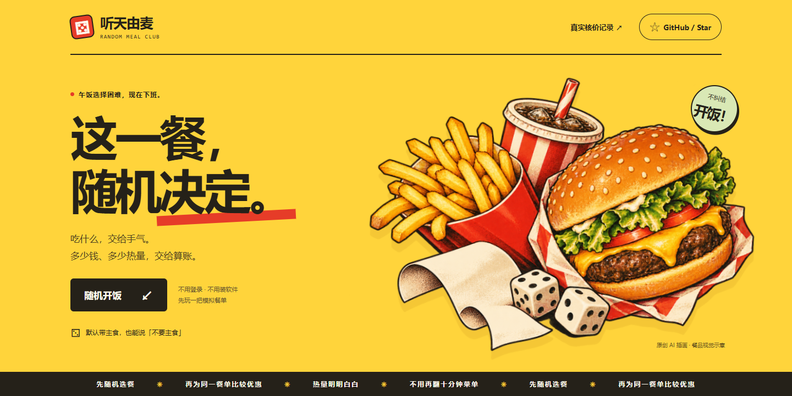
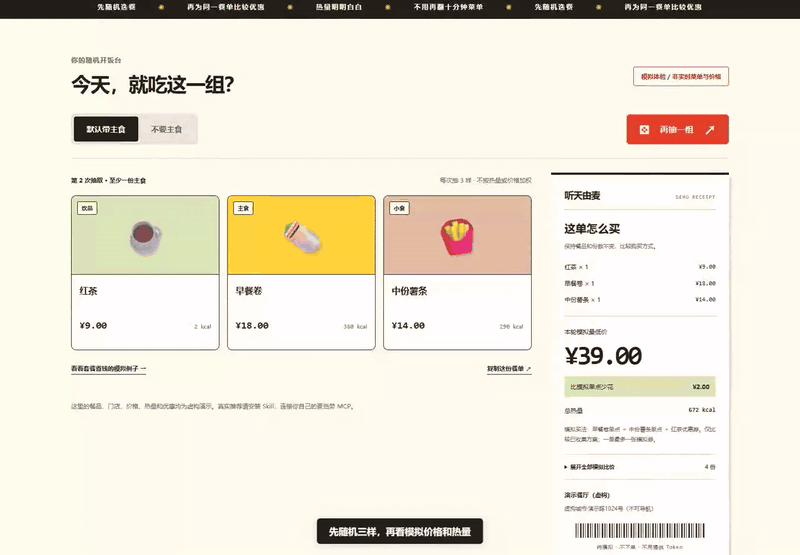
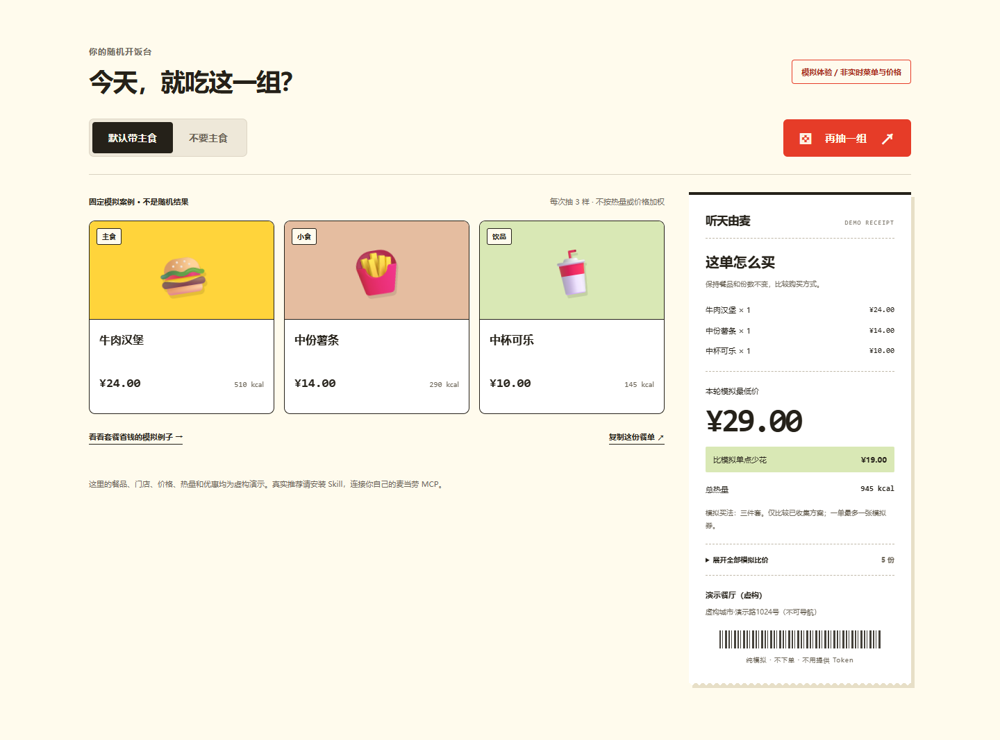
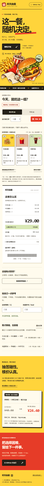

# 听天由麦 · mcd-random-meal

不知道吃什么？从当前门店的餐品里随机抽三样，展示门店地址、价格和热量，再为同一份餐单比较优惠买法。默认至少一份主食；说“不要主食”就排除汉堡、卷、饭、面、粥、三明治等。薯条按小食处理。

**[在线试玩 →](https://ting-tian-you-mai-demo.silkypony128.chatgpt.site)** · [35 秒新版录屏](assets/demo.mp4) · [安装 Skill](#安装-skill)



## 先玩一把

无需登录、无需 Token，打开网页即可随机三样、切换“不要主食”、查看每份热量并比较同一餐单的购买方式。网页使用**虚构模拟数据**；真实门店查询和官方核价由本机 Skill 完成。网页还单独展示已完成的真实联调历史记录。

抽签时有短促骰子动效与揭晓反馈，连续点击不会重复抽取。最近6份餐单和当前餐单可在此浏览器恢复，也可复制链接让朋友打开同一份模拟餐单。可选填预算与热量参考值：只提示差额，不筛选餐品、不改变随机概率。浏览器禁止存储或复制时会提示替代方式；系统开启“减少动态效果”后会关闭非必要动效。



<details>
<summary>查看桌面与手机效果图</summary>

桌面截图展示固定模拟案例（不是一次随机结果）：相同三样餐品模拟单点48元，组合为模拟套餐29元。





</details>

新版录屏约35秒，直接录制已部署网页的真实操作，展示骰子抽签、不要主食、历史恢复、预算/热量提醒，以及复制并打开分享链接。分享链接也已用全新浏览器会话验证能恢复同一份餐单。带中文字幕，无旁白；H.264 MP4约3MB，适合随群消息发送。[下载 MP4](assets/demo.mp4) · [群分享文案](assets/group-post.txt)。原创插画由内置 image_gen 生成，[完整提示词与素材说明](assets/image-prompt.md)随项目保留。

本项目为麦当劳程序员创意开发大赛参赛作品，由参赛者独立开发，非麦当劳官方产品。

项目仓库：https://github.com/dayebishouji/mcd-random-meal

参赛报名：[官方报名 Issue #1196](https://github.com/M-China/mcd-developer-innovation-challenge/issues/1196)，报名状态以该 Issue 下的官方回执为准。

## 使用示例

- “深圳福田，随机推荐麦当劳，给我地址、价格和热量。”
- “不要主食，重新随机三样，再帮我算优惠。”
- “这一组挺好，保持餐品不变，看看套餐买会不会更便宜。”

目标用户：不想反复翻菜单、希望看到真实价格与热量的普通用户。随机规则不按热量、价格、热门程度或优惠加权。默认规格参与抽取，可能抽到多份主食；不支持用“随机”掩饰人工挑选。

## 安装 Skill

需要 Python 3.10 或更新版本，无第三方依赖。将整个 `mcd-random-meal` 文件夹复制到所用 Agent 的技能目录，例如 Codex 的用户技能目录或 WorkBuddy 的用户技能目录；保持 `SKILL.md`、`scripts/`、`references/` 同级。由 Agent 加载 `SKILL.md` 并使用已连接的麦当劳 MCP。

```text
git clone https://github.com/dayebishouji/mcd-random-meal.git
cd mcd-random-meal
```

本机命令模式需要自行在私有环境中设置 `MCD_MCP_TOKEN`。不要把真实 Token 放进源码、公开配置、截图或命令行参数。配置模板只含环境变量占位符，不保证所有客户端都会自动展开，需按客户端实际配置方式处理。

## 先看离线演示

```text
python scripts/main.py demo
python scripts/main.py demo --no-main
```

打开生成的 `local/demo.html`。所有演示门店、价格、优惠和热量均为虚构，醒目标注“离线模拟”。每次执行重新抽取；测试复现可加 `--seed 24`。JSON 和 HTML 使用同一次抽取结果。

Windows 也可双击 `run-demo.cmd`，每次重新抽取后打开报告；不运行 Python 也能先查看 `examples/demo.html` 和 `examples/demo-no-main.html` 两份静态样例。

## 真实推荐

环境变量配置好后：

```text
python scripts/main.py live --city 深圳市 --keyword 福田
python scripts/main.py live --city 深圳市 --keyword 福田 --store-code 1420450 --no-main
```

打开生成的 `local/live.html`。未指定门店时，使用接口返回的首家营业门店，并在结果中说明；接口距离对应搜索地标，不代表到用户实际位置的距离。餐厅地址以本轮官方回执为准。

真实模式查询菜单、默认规格、营养和当前门店已有券。选餐后比较等价单点、套餐与已有券，并由官方 `calculate-price` 核价。不创建订单、不领券、不兑换、不支付。

## 怎么算

1. 过滤非餐品、未知分类和需新增开卡的入口；餐品缺热量仍参加随机。
2. 从符合条件的不同餐品组合中等概率抽取，默认三样且至少一份主食；不要主食时至少一样是食物，避免三杯饮品。
3. 按实际默认规格匹配官方每份营养。未匹配部分显示未知，不能当作0 kcal。
4. 固定餐品和份数，枚举等价购买方案。套餐按真实组成编码核对，不能为优惠擅自加餐或换规格。
5. 对方案整单核价，比较整数分金额，输出“本轮成功核价方案中的最低价”。

当前适配器最多解析60个单品入口、检查12个套餐入口、24份购买方案，限到店取餐默认规格。对规格未完整返回、分类不明或需新增会员的入口会排除，范围在报告和数据中说明。并非全平台最低价。没有可用券时如实显示，不虚构优惠。异常不会静默降级成模拟结果。

## 开发验证

```text
python -m unittest discover -s tests -v
```

真实调用与已验证范围见 `MCP_INTEGRATION.md`。未使用 WorkBuddy 开发，不提供或伪造 `workbuddy.md`。

在线演示的静态源码位于 `docs/`，与 Python 演示共用 `examples/demo.json` 的模拟餐品与优惠数据。网页与 Python 已对285种有效餐单进行精确金额对照；浏览器检查覆盖1440、768、390和360像素宽度、主食切换、固定案例、比价展开和减少动态效果偏好。无第三方前端依赖，不收集用户 Token。

如已安装 Node.js，可用 `python tests/check_web_parity.py` 重跑网页/Python 金额对照；此项开发检查不属于运行时依赖。

浏览器回归测试需另行安装 Playwright 和 Chromium。在下面的本地预览服务运行时，执行 `python tests/web_ui.py`；也可通过 `--browser-path` 指向本机 Edge。测试覆盖重复点击、键盘操作、分享恢复、历史记录、非法链接、输入校验、存储/剪贴板拒绝、未知热量、空报价，以及320–1440像素宽度。已在 Edge 和 Chromium 通过，不代表对所有浏览器或未来数据都能保证零错误。

本地预览：`python -m http.server 8765 --directory docs`，然后打开 `http://localhost:8765`。

## 许可证

原创源码采用 [MIT 许可证](LICENSE)。麦当劳商标、官方参赛声明及接口内容的权利归各自权利人所有。
